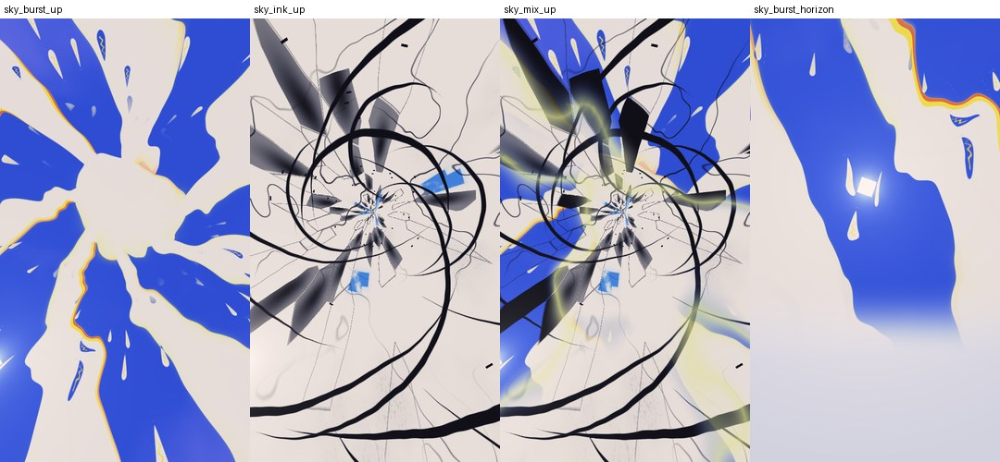
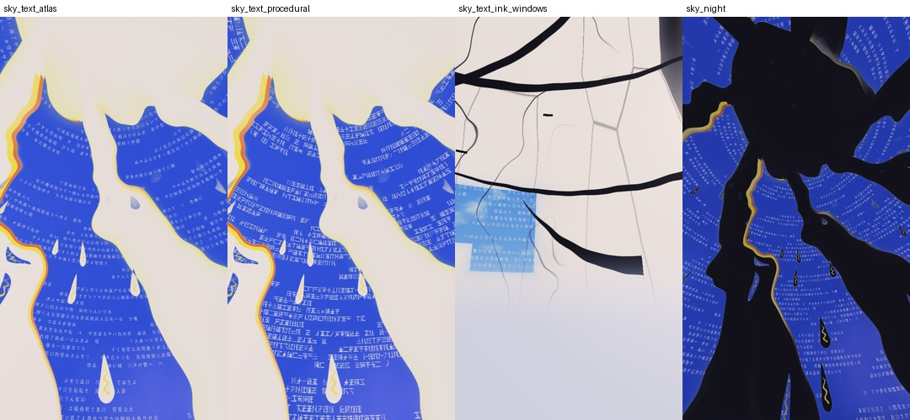
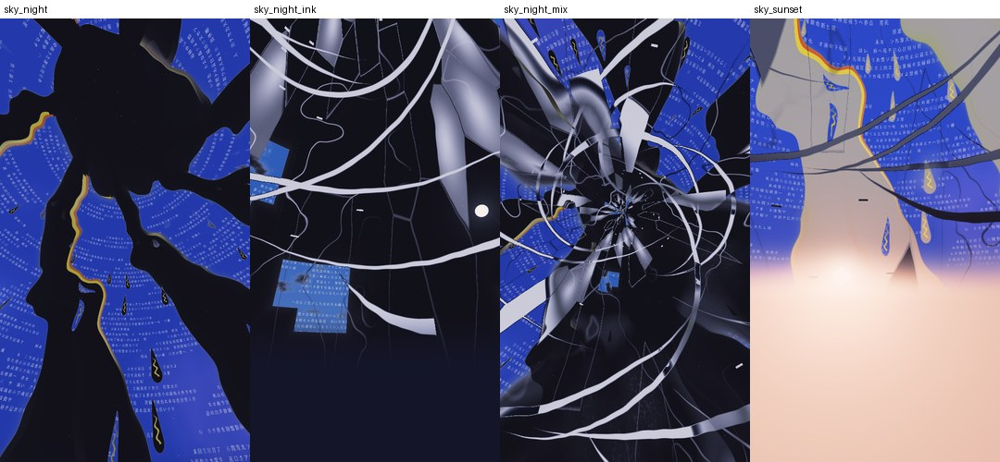
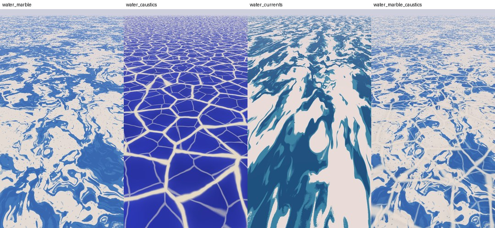
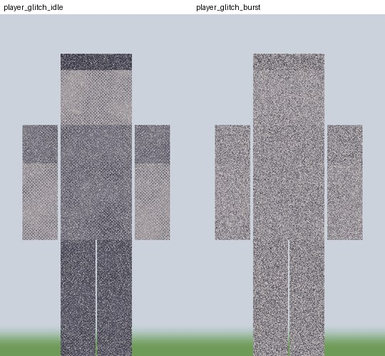

# AoiGlitch — шейдерпак для Minecraft 1.20.4 (Iris / OptiFine)

青 (ao, «синий») + glitch. Процедурное небо по двум референсам (сине-белый радиальный взрыв и
чёрно-белые чернильные осколки), японский «BSOD-терминал» на синих участках неба, стилизованная
вода (мрамор / каустика / течения), серые глитч-игроки с белым шумом, листва-«желе», колышущаяся
трава, мягкое «живое» освещение с лучами, bloom и пастельной дымкой (и опциональная мозаика вдали).







*Превью отрендерены тем же GLSL-кодом из `shaders/lib/` через WebGL2 (`tools/preview/`).
Это сами функции, а не скриншоты из игры.*

---

## Установка

1. Скопируйте папку `AoiGlitchShaders` (или zip, внутри которого лежит `shaders/`) в `.minecraft/shaderpacks/`.
2. Iris 1.7+ (рекомендуется) или OptiFine HD U I7+ для 1.20.4.
3. Видео → Пакеты шейдеров → **AoiGlitchShaders**. Все настройки — в «Настройки шейдеров» (есть русский перевод).

## Структура

```
shaders/
  shaders.properties        облака off, солнце/луна off, custom uniforms, атлас, меню
  block.properties          ID листвы / травы / воды / источников света -> mc_Entity.x
  entity.properties         entity.10000 = player -> uniform entityId
  gbuffers_skybasic.*       процедурное небо            (lib/sky.glsl)
  gbuffers_skytextured.*    гасим ванильные солнце и луну
  gbuffers_clouds.*         discard — облаков нет
  gbuffers_terrain.*        трава + листва-желе (vsh), мягкий свет (fsh)
  gbuffers_water.*          процедурная вода            (lib/water.glsl)
  gbuffers_entities.*       серый глитч игроков         (lib/glitch.glsl)
  gbuffers_hand.*           рука и предмет в руке       (lib/generic.glsl)
  gbuffers_textured(_lit).*, gbuffers_basic.*, gbuffers_spidereyes.*,
  gbuffers_armor_glint.*, gbuffers_beaconbeam.*   частицы, дождь, обводка блока, свечение
  shadow.*                  карта теней (та же анимация растений)
  composite.fsh             дымка/туман, японский текст (lib/kanji.glsl), лучи света
  composite1.fsh            bloom: bright pass
  composite2.fsh            bloom: размытие по mip-уровням
  composite3.fsh            bloom (+ мозаика по глубине, выключена по умолчанию)
  final.fsh                 цветокоррекция              (lib/grading.glsl)
  lib/settings.glsl         ВСЕ опции (#define)
  lib/params.glsl           «пульт»: имена параметров из ТЗ + custom uniforms
  textures/jp_atlas.png     атлас 16x16 японских глифов
tools/
  validate.py               компиляция всех программ glslangValidator'ом
  make_atlas.py             генерация атласа из любого японского шрифта
  preview/preview.mjs       рендер неба/воды/глитча в PNG (WebGL2)
  preview/post.mjs          прогон composite1..final на любом скриншоте
```

### Буферы и проходы

| Буфер | Формат | Кто пишет | Что внутри |
|---|---|---|---|
| `colortex0` | RGBA16F | все gbuffers, composite, composite3 | цвет сцены (солнце в HDR > 1 для bloom) |
| `colortex2` | RGBA8 | gbuffers_skybasic, skytextured | r — маска «здесь можно текст», g — «здесь нарисовано небо» |
| `colortex3` | RGBA16F + mipmaps | composite1 | яркие участки (bright pass) |
| `colortex4` | RGBA16F | composite2 | размытый bloom |
| `colortex12` | — | — | (только OptiFine) слот атласа глифов |

`gbuffers_*` → `composite` (туман + текст) → `composite1` (bright) → `composite2` (blur) →
`composite3` (bloom + мозаика) → `final` (грейдинг). Форматы объявлены комментарием в начале
`composite.fsh`, mip-карты `colortex3` — константой `colortex3MipmapEnabled` в `composite2.fsh`.

---

## 1. Небо (изображения 1 и 2) — `lib/sky.glsl`

**Сфера → плоскость.** В `gbuffers_skybasic.fsh` для каждого пикселя восстанавливается мировое
направление взгляда (`gl_FragCoord` → `gbufferProjectionInverse` → `gbufferModelViewInverse`),
ванильный цвет неба игнорируется. Направление переводится в «рыбий глаз» вокруг оси (зенит или
солнце): `p = a · θ / sin θ / (π/2)`, где θ — угол до оси. Горизонт = `|p| = 1`. Все искажения
делаются в этих координатах, поэтому они бесшовны, а `atan` берётся уже от искажённой точки.

### Стиль 1 — радиальный взрыв (`skyBurst`, `burstField`)

1. **Domain warping:** `q = p + k · fbm2(p·1.9 + 2.6 · fbm2(p·1.2))` — двухуровневое искажение
   (приём Иниго Квилеза) превращает геометрическую спираль в текучие лепестки.
2. **Полярные координаты:** `r = length(q)`, `a = atan(q.y, q.x)`.
3. **Лучи:** `rays = cos(N · (a + twist·√r + t·ω) + warp · fbm(cos a, sin a, r))`.
   `N` целое → `cos(N·a)` непрерывен на шве ±π; FBM берётся на окружности `(cos a, sin a)` —
   тоже без шва. Порог `th(r)` уменьшается к горизонту — лучи расширяются (перспектива снизу).
4. Знаковое поле `f = rays − th`, белое там, где `f > 0`; край сглаживается через `fwidth(f)`.
5. **Жёлто-оранжевые края** — «сбитая приводка» шелкографии: поле пересчитывается со сдвигом
   (`q − off`, `q − 2.4·off`); где синяя форма сдвинута, а здесь белое — тонкая оранжевая, потом
   жёлтая кайма. Маска шума оставляет кайму только на части краёв, как у силуэта на референсе.
6. **Капли** — ячейки в координатах `(угол, log r)`: размер растёт к горизонту, `log r − t·v`
   двигает их наружу, SDF капли = круг-голова + сужающийся хвост, внутри жёлтый штрих.
   Белые капли на синем, синие на белом.
7. Перивинкл-облака в синих зонах, лимонное свечение у краёв, персиковые/серебряные «волокна».

### Стиль 2 — чернильные осколки (`skyInk`)

* **Лезвия:** серп = круг минус смещённый круг, `max(|q−c|−R, −(|q−c₂|−R₂))` — SDF с идеально
  острыми «рогами», как у каллиграфического росчерка.
* **Каллиграфические дуги:** `| |q−c| − R | − w(u)`, толщина `w` падает вдоль дуги — тупое начало,
  волосяной конец.
* **Каракули:** нулевые изолинии градиентного шума с очень узким порогом
  `1 − smoothstep(0, ε, |noise|)`.
* **Осколки:** Вороной в координатах `(угол·30, log r)` → вытянутые радиальные клинья; часть
  ячеек залита с градиентом «стекла», у части обведены края (`F2 − F1`).
* **Окна неба** — прямоугольники в сетке (азимут, высота) со ступенчатым углом и голубым ореолом,
  внутри голубое небо с FBM-облаками; плюс мелкие чёрные глитч-плашки.
* Время «дёргается»: раз в ~2 с с вероятностью 28 % вся графика резко поворачивается.

### Смешивание (`getCustomSky`)

`SKY_STYLE`: 0 — взрыв, 1 — осколки, 2 — смешивание с `SKY_MIX`, 3 — авто-морфинг по
custom uniform `skyMorph` (период 120 с). Смешивание — не простой crossfade: FBM-порог
«растворяет» один стиль в другом (`bRegion = 1 − smoothstep(m−0.06, m+0.06, fbm)`), по шву
проходит лимонное свечение, а чёрные штрихи стиля 2 ложатся поверх взрыва.

Дальше: день/закат/ночь (`skyTimeOfDay`), дымка у горизонта того же цвета, что и туман
(бесшовный горизонт), звёзды, **солнце-ромб** (L1-норма в касательной плоскости, HDR ×4 → bloom,
как на изображении 10) и мягкая луна.

**Ночь (`SKY_NIGHT_STYLE = 1`)** — палитра переворачивается, а не просто тускнеет. Для каждого
цвета считается насыщенность `sat = (max − min) / max`:

* нейтральные цвета (белое, серое) → `(1 − яркость)^1.25` — **белые лучи и капли становятся
  чёрными**, а чёрные штрихи стиля 2 — светлыми (иначе они исчезли бы на чёрном);
* насыщенные (синий, перивинкл, окна неба) → `цвет × (0.66, 0.70, 0.78)` — **синий слегка темнеет**;
* жёлто-оранжевые края остаются тусклым «неоном»; звёзды теперь видны и на чёрных участках.

Переход идёт плавно по высоте солнца. `SKY_NIGHT_STYLE = 0` — старая «притушенная» ночь.

### Отключение облаков

Два уровня: `clouds = off` в `shaders.properties` (игра вообще не отправляет геометрию облаков) и
`gbuffers_clouds.fsh` с `discard` — страховка, если облака включит мод или загрузчик.
Ванильные солнце/луна: `sun = false`, `moon = false` + `discard` по `renderStage` в
`gbuffers_skytextured.fsh`.

### Параметры

| Опция (GUI) | Имя в GLSL | Смысл |
|---|---|---|
| `SKY_STYLE` | `skyStyle` | 0/1/2/3 |
| `SKY_MIX` | `skyMix` | доля стиля 2 при `SKY_STYLE = 2` |
| `SKY_WARP` | `skyWarpStrength` | сила domain warping |
| `SKY_SPEED` | `skySpeed` | скорость анимации |
| `SKY_RAYS`, `SKY_TWIST`, `SKY_BURST_CENTER`, `SKY_INK_DENSITY`, `SUN_SIZE` | | форма |
| — | `skyMorph` (custom uniform) | `0.5 + 0.5·sin(frameTimeCounter·0.0524)` |

---

## 2. Японский текст на синем небе (изображение 6) — `lib/kanji.glsl`

### Маскировка

Текст рисуется в `composite.fsh` только на пикселях неба (`depth == 1`) и только если оба условия:

1. **маска узора** `colortex2.r` — её пишет само небо: «синие зоны» (не лучи, не капли, не
   солнце, не дымка);
2. **маска цвета** — `smoothstep(0.10, 0.30, (b − max(r, g)) / b)`: «синесть» итогового цвета.
   Белые лучи, облака, ореолы, дождливое серое небо и закатная дымка её не проходят.

Вторая маска — то, что просили (`smoothstep` по синему каналу); первая нужна, потому что ночью
«белые» лучи становятся сине-лиловыми и одной цветовой маски уже мало.

### Сетка на сфере

Строки = полосы одинаковой высоты над горизонтом; в каждой строке **целое** число колонок
`floor(2π·cos(высота) / ширина глифа)` — глифы не сплющиваются к зениту, а азимут замыкается без
шва. Сверху «вёрстка терминала»: блоки по 30 символов, рваный правый край, пустые строки, пробелы.

### Вариант 1 — текстурный атлас (по умолчанию, `SKY_TEXT = 1`)

`textures/jp_atlas.png` — 16×16 глифов (хирагана, катакана, кандзи «ошибка/сон/небо»), белым по
чёрному. Номер глифа `floor(hash(cell, epoch) · 256)`; `epoch = floor(t · rate(cell) + phase)` —
каждая ячейка переписывает свой символ со своей скоростью. Выборка 4 точками со сдвигом по
производным сетки — глифы не рябят при уменьшении.

Подключение (уже в `shaders.properties`):

```properties
# Iris: привязка по имени сэмплера -> uniform sampler2D jpTextAtlas;
customTexture.jpTextAtlas = textures/jp_atlas.png
# OptiFine: классический слот кастомной текстуры для composite-стадии
texture.composite.colortex12 = textures/jp_atlas.png
```

```glsl
#ifdef IS_IRIS
uniform sampler2D jpTextAtlas;
#else
uniform sampler2D colortex12;
#define jpTextAtlas colortex12
#endif
```

Свой шрифт: `python3 tools/make_atlas.py путь/к/шрифту.ttf`. `jp_atlas.png.mcmeta` включает
линейную фильтрацию и clamp.

### Вариант 2 — процедурные псевдо-кандзи (`SKY_TEXT = 2`, текстура не нужна)

`proceduralGlyph`: глиф = 3–7 штрихов, выбранных битами хеша из «словаря» кандзи: горизонтали,
вертикаль, левый ключ (亻/氵), рамка 口, откидные ノ и 乀, точка 丶. Каждый штрих — SDF отрезка
`sdSegment`, толщина через `aaFill` — плотный нечитаемый текст.

### Мерцание и глитч

* мерцание: каждые 0.1 с ~12 % ячеек притухают на 40 %;
* глитч: время режется на слоты по 0.25 с; слот «срабатывает» с вероятностью 9 % — полоса из
  нескольких строк уезжает вбок на случайное число символов, часть ячеек **инвертируется**
  (белый блок с вырезанным глифом);
* постоянный мелкий джиттер строк, как у плохого видеосигнала;
* зерно: альфа текста умножается на `smoothstep(0.12, 0.55, hash(пиксель, кадр))` — точечный,
  «напечатанный» вид как на референсе. Цвет — чистый `vec3(1.0)`.

Опции: `SKY_TEXT`, `SKY_TEXT_SIZE`, `SKY_TEXT_DENSITY`, `SKY_TEXT_OPACITY`, `SKY_TEXT_FLICKER`,
`SKY_TEXT_GLITCH`, `SKY_TEXT_GRAIN`.

---

## 3. Вода (изображения 3, 4, 5) — `lib/water.glsl`, `gbuffers_water.*`

Вода опознаётся через `block.10010 = water` → `mc_Entity.x`; остальные полупрозрачные блоки
(стекло, лёд, слизь) освещаются как обычно. Узор привязан к **мировым** координатам
(`playerPos + cameraPosition`), на боковых гранях водопадов — `(x+z, y)`, поэтому течёт вниз.

* **0 — мрамор (изобр. 3):** `q = fbm2(p)`, `r = fbm2(p + 3.5q)`, `f = fbm(p + 3.5r)`;
  полосы = изолинии `sin(2π(2.4f + 0.6r.x))`, порог полос сдвигается высокочастотным шумом →
  зернистые «печатные» края; плюс брызги-точки.
* **1 — каустика (изобр. 4):** Worley: `F1` — расстояние до ближайшей точки, `F2` — до второй.
  `F2 − F1 = 0` ровно на границах ячеек → `1 − smoothstep(0, w, F2−F1)` даёт тонкие светлые
  линии; у тройных стыков разность мала на большей площади → яркие узлы. Точки вращаются внутри
  ячеек, домен слегка искажён FBM, второй слой мельче, «тканевая» фактура линий.
* **2 — течения (изобр. 5):** то же искажение, но в системе координат потока: ось вдоль течения
  растянута (×0.5) и сдвигается со временем (адвекция) → длинные изогнутые полосы
  пена/бирюза/глубина.
* **3 — мрамор + сетка каустики поверх.**

Зерно затухает, когда ячейка шума становится меньше пикселя (`fwidth`), иначе вдали была бы рябь.
Свет — ванильный lightmap (ночью и в пещерах вода темнеет), френель делает воду под скользящим
углом плотнее и подмешивает цвет дымки. Альфа `WATER_ALPHA` → блендинг в `colortex0`, дальше на
воду действует общий туман из `composite`.

Опции: `WATER_STYLE` (`waterStyle`), `WATER_SCALE`, `WATER_SPEED`, `WATER_WARP`, `WATER_GRAIN`,
`WATER_ALPHA`.

---

## 4. Игроки: серый глитч + белый шум (изображение 7) — `lib/glitch.glsl`, `gbuffers_entities.*`

**Изоляция:** Iris и OptiFine выставляют `uniform int entityId` = номеру из `entity.properties`
для каждой рисуемой сущности. `entity.10000 = player` → эффект включается только при
`entityId == 10000` (или для всех сущностей с `GLITCH_ALL_ENTITIES`). Небо, вода и блоки вообще
не проходят через `gbuffers_entities`, так что их это не касается. Силуэт — альфа текстуры
(`discard` при `alpha < 0.1`).

* **Серый:** `gray = dot(color, vec3(0.299, 0.587, 0.114))`, слегка прижат к середине; свет —
  только яркость lightmap, чтобы цвет не возвращался.
* **Глитч:** время режется на слоты (0.5 с / `GLITCH_RATE`); в ~18 % слотов короткий «срыв
  сигнала». Во время срыва экран режется на полосы случайной высоты и часть полос сдвигает
  `texcoord.x` (рваная развёртка), в вершинном шейдере вся фигура на кадр «прыгает» вбок/вверх,
  а тело ненадолго тонет в помехах. Если сдвиг попал в прозрачный пиксель скина, берётся исходный
  цвет — дыр не бывает.
* **Белый шум:** `hash(gl_FragCoord.xy + кадр)` при 24 кадрах/с — новое случайное число на пиксель
  каждый кадр; `step(порог, noise)` превращает его в жёсткие белые точки.
* **Полутон (как изобр. 7):** сетка точек под 45°, радиус точки задаёт плавающий FBM → облака
  более и менее плотных чёрных точек. `NOISE_STYLE`: 0 — помехи, 1 — точки, 2 — оба.
* Плюс сканлайны.

Опции: `PLAYER_GLITCH`, `GLITCH_ALL_ENTITIES`, `GLITCH_INTENSITY` (`glitchIntensity`),
`NOISE_AMOUNT` (`noiseAmount`), `NOISE_STYLE`, `GLITCH_RATE`.

---

## 5. Листва-желе — `lib/foliage.glsl`, `gbuffers_terrain.vsh`, `shadow.vsh`

**Полотно (глобальный ветер)** `windCanvas`: одно гладкое векторное поле на весь мир — бегущая
вдоль ветра волна порывов `sin(dot(xz, dir)·0.21 − 1.25t)²` (полосы ветра бегут по лесу), более
быстрое покачивание с плавно меняющейся фазой и мелкая 3D-дрожь. Вся крона смещается им как одна
простыня (амплитуда 0.045 блока).

**Желе** `jellyOffset`: сумма трёх бегущих синусоид
`d = A·Σ aᵢ·eᵢ·sin(kᵢ·P − ωᵢt)`, где

* `|kᵢ| ≈ 8–10 рад/блок` → длина волны < 1 блока → **несколько узлов колебаний внутри каждого
  блока** (объём);
* `ωᵢ = 2π·JELLY_FREQUENCY·{1, 1.27, 0.83}` — высокая частота, без видимого повтора;
* амплитуда `JELLY_AMPLITUDE` = 0.03 блока; порыв ветра её увеличивает.

**Важно:** вместо локальных координат вершины внутри блока (`fract`, `gl_Vertex`) берётся
непрерывная мировая позиция. Иначе у общей вершины соседних блоков локальные координаты 0 и 1 →
разные смещения → **трещины** между блоками. С непрерывным полем общая вершина двигается одинаково.

**Нормали:** для `x' = x + d(x)` нормаль деформированной поверхности в первом порядке
`n' = normalize(n − Jᵀn)`, `J = Σ A·aᵢ·cos(фазаᵢ)·eᵢkᵢᵀ`, то есть
`Jᵀn = Σ A·aᵢ·cos(фазаᵢ)·(eᵢ·n)·kᵢ` — точная аналитическая производная тех же синусоид.
Освещение «переливается» вместе с желе, ничего не плоское и без артефактов. В теневом проходе
применяется то же смещение, поэтому тени тоже трясутся.

ID в `block.properties` (Iris 1.7+ понимает и теги, `block.10001 = #minecraft:leaves`):

```properties
block.10001 = oak_leaves spruce_leaves birch_leaves jungle_leaves acacia_leaves \
  dark_oak_leaves mangrove_leaves cherry_leaves azalea_leaves flowering_azalea_leaves
```

Опции: `JELLY_LEAVES`, `JELLY_AMPLITUDE` (`jellyAmplitude`), `JELLY_FREQUENCY` (`jellyFrequency`,
Гц), `WIND_SPEED` (`windSpeed`), `WIND_STRENGTH` × custom uniform `windStrength`.

---

## 6. Мозаика вдали (изображение 8) — `lib/pixelate.glsl`, `composite3.fsh`

> **По умолчанию выключена** (`PIXELATION`). Включается в «Настройки шейдеров → Мозаика вдали».

**Дистанция:** из `depthtex0` восстанавливается позиция во view space
(`gbufferProjectionInverse · (uv, depth)·2−1`, деление на w) и берётся её длина — честное
расстояние, без искажений к краям экрана. Есть и классическая `linearizeDepth`:
`2nf / (f + n − z(f − n))`, `z = depth·2 − 1`.

**Размер:** `pixelSize = mix(1, PIXEL_MAX_SIZE, smoothstep(PIXEL_START_DISTANCE, PIXEL_END_DISTANCE, dist))`,
небо (`depth = 1`) — `PIXEL_SKY_SIZE`.

**Проблема наивного подхода:** если каждый пиксель сам выбирает размер своей клетки, клетки разных
размеров перекрываются и рвутся. **Решение — квадродерево:** размеры только степени двойки
(32, 16, 8, 4, 2), сетки выровнены, и плитка размера `s` используется, если нужный размер **в её
центре** ≥ s. Все пиксели плитки видят один и тот же центр → одно решение → ровная мозаика.

**Плавность:** результат смешивается от плитки `s` к родительской `2s` с коэффициентом
`log2(pixelSize) − log2(s)` (через smoothstep) — размер растёт непрерывно, без скачков.
Цвет плитки — среднее 16 билинейных выборок (точный бокс-фильтр до 8 px) → плитки не мерцают
при движении. Светлые швы между плитками (`PIXEL_GROUT`) — как у кафельной мозаики референса.

Буферы: отдельной настройки не нужно — в composite-проходах Iris/OptiFine сами делают ping-pong,
поэтому `composite3` читает `colortex0` и пишет в него же.

Опции: `PIXELATION`, `PIXEL_START_DISTANCE` (`pixelStartDistance`), `PIXEL_END_DISTANCE`,
`PIXEL_MAX_SIZE` (`pixelMaxSize`), `PIXEL_SKY_SIZE`, `PIXEL_GROUT`.

---

## 7. Трава и «мечтательное» освещение (изображения 9, 10, 11)

### Шелест травы — `plantWave`

* **Низ/верх:** у растения-«крестика» верхние вершины берут верхнюю половину текстуры:
  `gl_MultiTexCoord0.t < mc_midTexCoord.t` → вершина наверху. Для высоких растений
  (`tall_grass`, `sunflower`, …) в `block.properties` разные ID для `half=lower` и `half=upper`:
  нижняя половина 0 → 0.5, верхняя 0.5 → 1. Общая вершина на стыке получает одинаковый вес.
* **Изгиб:** смещение `∝ ветер · h²` — как у консольной балки: корень неподвижен, верхушка
  гнётся сильнее всего. Верхушка ещё и чуть опускается (`|offset|² / 2H`), чтобы стебель не
  растягивался.
* **Ветер:** то же полотно `windCanvas` — постоянный наклон по `windDirection` + бегущие по лугу
  порывы + покачивание. Все растения гнутся в одну сторону — единый поток.
* `windDirection` и `windStrength` — **настоящие custom uniforms** из `shaders.properties`:
  направление плавно гуляет ±20°, сила растёт в дождь; опции GUI `WIND_STRENGTH` и `WIND_SPEED`
  умножаются на них.

### Bloom — `composite1/2/3`

* **Bright pass:** светится только **избыток** яркости над порогом:
  `bright = color · max(L − T, 0) / L` (с мягким коленом). Белые блоки дают лёгкий ореол,
  HDR-солнце (L ≈ 4), лава и источники света (`block.10020`, слегка усилены) — сильный.
* **Размытие:** у `colortex3` включены mip-карты; mip-уровень *i* — это уже среднее по
  2ⁱ×2ⁱ пикселей. На уровнях 1–6 берётся tent-фильтр 3×3 и всё суммируется с весами, растущими к
  широким уровням → широкий мягкий гауссоподобный ореол за 54 выборки.
* Сложение в `composite3` (`BLOOM_INTENSITY`), затем мягкое «плечо» в `final` вместо клиппинга.

### Дымка — `lib/atmosphere.glsl`, `composite.fsh`

* **Цвет:** ванильный `fogColor` (знает биом, время суток, измерение), сдвинутый к пастели, + тёплый
  ореол вокруг солнца (`pow(dot(dir, sun), 6)`, на закате персиковый) — как на изобр. 10.
  Тот же цвет у горизонта неба → шов «земля/небо» не виден.
* **Плотность:** `1 − exp(−dist·density)` с высотным спаданием (в низинах гуще) и
  `smoothstep(0.55·far, 0.98·far, dist)` — дальние чанки растворяются до края прорисовки (изобр. 11).
* Под водой / в лаве / в рыхлом снегу — свой туман.

### Цветокоррекция — `lib/grading.glsl`, `final.fsh`

* мягкое плечо: выше 0.75 значения экспоненциально подходят к 1 — ничего не выгорает;
* **вибранс:** насыщенность растёт сильнее у ярких и ещё не насыщенных цветов, уже насыщенные
  почти не трогаются — «больше цвета без выгорания»;
* **пастель:** светлые тона чуть уводятся в белый, контраст немного снижен;
* сплит-тонинг: тени фиолетово-синие, света персиковые;
* **lift:** `c = c·(1 − lift) + lift·(0.62, 0.55, 1.0)` — чёрный становится мягким лавандовым;
* виньетка и плёночное зерно (заодно убирает бандинг).

### Живой свет — `lib/lighting.glsl`, `composite.fsh` (меню «Живой свет»)

Свет меняется во времени и в пространстве, но остаётся мягким: все эффекты только слегка
подкрашивают и ослабляют ванильный lightmap, жёстких переходов нет.

* **Цвет света по времени суток** (`sunLightColor`): золотой на рассвете и закате, тёплый
  белый днём, голубой лунный ночью. Тень берёт дополнительный цвет — лавандовый днём,
  фиолетово-розовый в «золотой час». Сверху поверхности чуть холоднее (небо), снизу теплее
  (отражённый от земли свет).
* **Плывущие пятна света** (`LIGHT_PATCHES`, `lightPatches`): тонкий слой FBM на высоте 220
  проецируется на землю вдоль направления солнца и сдвигается ветром (~2 блока/с). По лугам и
  лесу медленно ползут мягкие пятна света и тени, как от облаков. Края очень широкие.
* **Лучи света** (`GODRAYS`, `lightShafts` в `composite.fsh`): от пикселя к солнцу (ночью — к
  луне) на экране берётся 20 выборок глубины и считается, сколько открытого неба по пути.
  Деревья, рельеф и рука его перекрывают — сквозь просветы падают мягкие тёплые лучи. Над
  открытым небом лучи ослаблены до лёгкой вуали (там уже светит bloom); старт выборок
  дизерингуется, полос нет.
* **Тёплый свет факелов** (`TORCH_FLICKER`): к блочному свету добавляется тёплое пятно
  `(1, 0.68, 0.42) · block³`, которое едва заметно «дышит»: мерцание — гладкая функция времени и
  позиции, поэтому соседние факелы мерцают по-разному.
* **Листва на просвет** (`FOLIAGE_GLOW`): если смотреть сквозь листья или траву на солнце, они
  светятся цветом света: `pow(max(dot(взгляд, свет), 0), 5)`.

### Мягкие тени — `lib/lighting.glsl`

* Ванильный lightmap остаётся основой (день/ночь, факелы, ночное зрение, гамма — всё работает).
* Тень от солнца лишь **ослабляет** его: `shade = 1 − SHADOW_DARKNESS · skyLight · (1 − sunVis)` —
  полная тень не темнее ~60 %, только там, куда достаёт небо, слабее ночью и в дождь.
* Диффуз с «обёрткой» `(N·L + 0.55) / 1.55` — широкий мягкий терминатор вместо резкой границы.
* PCF на 12 выборок по диску Фогеля (золотой угол), повёрнутому шумом IGN на каждый пиксель,
  радиус ~0.35 блока × `SHADOW_SOFTNESS` (по умолчанию 1.6) → широкая мягкая полутень;
  normal offset против акне. Полная тень по умолчанию не темнее ~66 % (`SHADOW_DARKNESS` 0.34).
* Тёплый тон на свету, прохладный лавандовый в тени; AO смягчено (`separateAo = true`,
  `AO_STRENGTH`).

### Параметры

| Опция (GUI) | Имя в GLSL | |
|---|---|---|
| `WIND_STRENGTH` | `windStrength` (× custom uniform) | сила ветра |
| `WIND_SPEED` | `windSpeed` | скорость |
| `BLOOM_INTENSITY` | `bloomIntensity` | сила свечения |
| `BLOOM_THRESHOLD` | | порог |
| `FOG_DENSITY` | `fogDensity` | плотность дымки |
| `COLOR_SATURATION` | `colorSaturation` | насыщенность |
| `PASTEL_AMOUNT`, `SHADOW_LIFT`, `SHADOW_DARKNESS`, `SHADOW_SOFTNESS`, `AO_STRENGTH` | | |
| `LIGHT_PATCHES_STRENGTH`, `GODRAYS_STRENGTH`, `FOLIAGE_GLOW`, `TORCH_FLICKER` | | живой свет |

### Рука, частицы, обводка — `lib/generic.glsl`

Если в паке нет программы, загрузчик идёт по цепочке
`gbuffers_hand → textured_lit → textured → basic`; когда в конце цепочки ничего нет, рука с
предметом (и частицы, и обводка блока) может вообще не рисоваться. Теперь вся цепочка есть.
Рука освещается тем же мягким светом, но без теней и пятен (её координаты не мировые);
частицы и дождь — ванильным lightmap; глаза пауков, блеск зачарований и луч маяка — fullbright.

---

## Как передаются параметры (uniforms)

В Iris/OptiFine нельзя из меню записать произвольное значение в `uniform`. Поэтому два механизма:

1. **Опции GUI** — `#define` со списком значений в `lib/settings.glsl`. В `lib/params.glsl` они
   доступны под именами из ТЗ (`skyStyle`, `jellyAmplitude`, `pixelMaxSize`, `glitchIntensity`,
   `noiseAmount`, …). Функции эффектов чистые — получают параметры аргументами, им всё равно,
   константа это или uniform.
2. **Custom uniforms** — выражения в `shaders.properties`, загрузчик пересчитывает их каждый кадр:

```properties
variable.float.windAngle  = 0.6 + 0.35 * sin(frameTimeCounter * 0.0174533)
uniform.vec2.windDirection = vec2(cos(windAngle), sin(windAngle))
uniform.float.windStrength = 1.0 + 0.9 * rainStrength
uniform.float.skyMorph     = 0.5 + 0.5 * sin(frameTimeCounter * 0.0523599)
```

Периоды (360 с и 120 с) делят 3600 с, поэтому при обнулении `frameTimeCounter` раз в час
скачка нет. Чтобы сделать настоящим uniform'ом любой другой параметр — замените в
`lib/params.glsl` `const float jellyAmplitude = JELLY_AMPLITUDE;` на `uniform float jellyAmplitude;`
и добавьте в `shaders.properties`, например, `uniform.float.jellyAmplitude = 0.03 + 0.02*rainStrength`.

---

## Проверка

```bash
python3 tools/validate.py
#  -> 304/304 compilations OK (38 programs x 4 option sets x 2 loaders)

NODE_PATH=$(npm root -g) node tools/preview/preview.mjs /tmp/previews
NODE_PATH=$(npm root -g) node tools/preview/post.mjs screenshot.png out.png horizon=0.42 sun=0.4,0.2
```

* `validate.py` раскрывает `#include` и опции так же, как загрузчик, добавляет макросы
  (`MC_VERSION`, `IS_IRIS`, `MC_RENDER_STAGE_*`) и компилирует каждую программу
  `glslangValidator`'ом (GLSL 1.20) для 4 наборов опций, с `IS_IRIS` и без.
* `preview.mjs` компилирует `lib/*.glsl` как GLSL ES 3.00 (строже, чем 1.20: нет неявных
  преобразований int→float) и рендерит небо, текст, воду и глитч — картинки выше оттуда.
* `post.mjs` прогоняет настоящие `composite → composite1 → composite2 → composite3 → final` на
  любом скриншоте с синтетической глубиной (яркое небо над линией горизонта = открытое небо) —
  так подбирались лучи, bloom, мозаика и грейдинг.

**В самой игре пак не запускался** (в среде сборки нет Minecraft). Вещи, которые стоит проверить в
первую очередь: рука и предметы в руке, смещение и мягкость теней (`SHADOW_SOFTNESS`,
`SHADOW_DARKNESS`), сила лучей и пятен света, амплитуды травы и листвы на реальной геометрии,
привязку атласа (если текста нет — переключите `SKY_TEXT` на 2, процедурный вариант текстуры
не требует).
